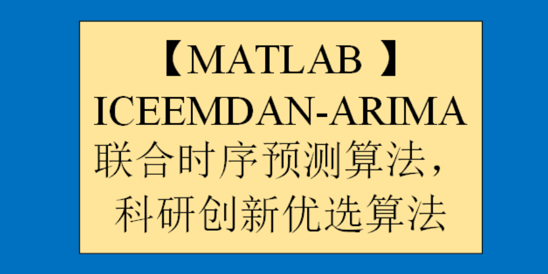

# [MATLAB] ICEEMDAN-ARIMA Joint Time Series Forecasting Algorithm, Preferred Research and Innovation Algorithm

To obtain the code, please refer to the end of this message for the method of obtaining the code.
1 ICEEMDAN Signal Decomposition Algorithm ICEEMDAN decomposition, also known as the improved adaptive noise complete ensemble empirical mode decomposition, is fully in English as "Improved Complete Ensemble Empirical Mode Decomposition with Adaptive Noise".
ICEEMDAN (Improved Complete Ensemble EMD with Adaptive Noise) is a signal decomposition method based on the Empirical Mode Decomposition (EMD). Unlike traditional EMD methods, ICEEMDAN introduces an adaptive noise and complete integration strategy to improve the stability and accuracy of the decomposition. In the ICEEMDAN method, firstly, EMD is used to decompose the original signal into multiple Intrinsic Mode Functions (IMF), then through an adaptive noise algorithm, the noise in each IMF is removed, and finally, the denoised IMFs are integrated completely to obtain the decomposed signal. Compared to traditional EMD methods, ICEEMDAN uses an adaptive noise algorithm to remove noise, which can reduce the problem of mode mixing during the decomposition process. Additionally, the complete integration strategy can ensure that the decomposed signal retains all information of the original signal, improving the accuracy of the decomposition. The ICEEMDAN decomposition method has been widely applied in signal processing, image processing, speech processing, and other fields, achieving high decomposition effects and reliability.
To use EMD decomposition in MATLAB, you first need to install the EMD decomposition MATLAB toolkit.
EMD Toolkit Installation: Open the package_emd folder in MATLAB, run the install_emd.M and index_emd.M functions as shown in the figure below to complete the installation of the toolkit.
MATLAB Signal Decomposition 5th Edition - ICEEMDAN:
For detailed information on the signal decomposition suite, please refer to:
2 ARIMA Time Series Forecasting Algorithm
The Autoregressive Integrated Moving Average (ARIMA) model is a predictive model based on time series analysis, suitable for analyzing and forecasting data with both temporal dependence and randomness. The ARIMA model was first proposed by Box and Jenkins in 1976 and has since become a widely used time series model for data prediction in production and finance sectors. The core idea of the ARIMA model is to differentiate the time series data to make it stationary, then establish the model through the combination of autoregression (AR) and moving average (MA), and use this model for forecasting. In the ARIMA model, "AR" stands for autoregression, indicating that current data are related to previous moments of data; "I" stands for differencing, which means to differentiate the data to make it stationary; "MA" stands for moving average, indicating that current data are related to errors from previous moments. The establishment process of the ARIMA model includes three steps: model identification, parameter estimation, and model verification. In the model identification phase, the order of the ARIMA model and the number of differencing times need to be determined; in the parameter estimation phase, the model needs to be estimated; in the model verification phase, the model needs to be verified and judged whether the prediction accuracy meets the requirements. The ARIMA model has several advantages, such as fully utilizing historical information of time series data for prediction, adaptability to various types of time series data, and good explanatory power. However, the ARIMA model also has some disadvantages, such as the need to differentiate non-stationary time series data, and the process of parameter estimation is relatively complex.
MATLAB | Time Series Forecasting | ARIMA Forecasting Model:
Details about 5 kinds of time series forecasting schemes can be found in the following document:
3 ICEEMDAN-ARIMA Joint Time Series Prediction Algorithm
The following will detail the principle and thought process of the latest ICEEMDAN-ARIMA Joint Time Series Prediction Algorithm.
Signal decomposition can break down raw data into N layers of imf components. Then, this study expands ARIMA time series prediction on each layer's imf component, and reconstructs the predicted values of the imf components to obtain the ICEEMDAN-ARIMA joint time series prediction value.
By comparing the ICEEMDAN-ARIMA joint time series prediction value with the pure ARIMA time series prediction value against the true values, we can find that the ICEEMDAN-ARIMA joint time series prediction algorithm has a good predictive effect. The reason is not hard to see; signal decomposition breaks down the raw data into different frequency data, which means that the frequencies of each layer's imf component are roughly the same, making it data with good periodicity and regularity. Therefore, when using the ARIMA time series prediction algorithm to predict each layer's imf component, its prediction effect will be closer to the true value.
Below is a brief video tutorial.
\n\n\n\n\n\nTo view this video please enable JavaScript, and consider upgrading to a web browser that supports HTML5 video

## Images

<!-- PAYMENT_BLOCK -->

## Get this dataset

- Payment link (Stripe): [Buy now](https://buy.stripe.com/3cs8yP7sY87d0vu9AB)
- Payment QR code: 

<!-- /PAYMENT_BLOCK -->
